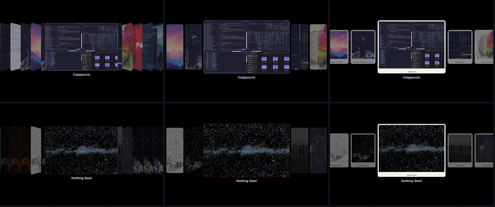

# Omarchy Image Picker Styles

[🇷🇺 Русский](README.ru.md)

Six styles for the [Omarchy](https://omarchy.org) image picker — the overlay behind the theme switcher and
the wallpaper switcher. A clone of the stock `omarchy.image-picker`; navigation, search and selection are
unchanged.



<!-- Demo video: repo-videos/omarchy-image-picker-styles.mp4 — drag it here when editing this file on GitHub -->

`slices` (stock), `cards`, `coverflow`, `polaroid`, `strip`, `wide`.

## Install

```sh
omarchy plugin add https://github.com/KamradSmeshnyavy/omarchy-image-picker-styles --enable
omarchy restart shell
echo '{"style": "coverflow"}' > ~/.config/omarchy/image-picker.json
```

Open it as usual: Super+Shift+Ctrl+Space (themes) or Super+Ctrl+Space (wallpapers). Back to the stock
picker: `omarchy plugin enable omarchy.image-picker`.


## Requirements

Omarchy 4 (Quattro) with its shell. Tested on Omarchy 4.0.6 with Quickshell 0.3.2.

- Optional: `libvips` for faster thumbnails (package `libvips`).

## Uninstall

```sh
omarchy plugin enable omarchy.image-picker      # switch back to the stock one first
omarchy plugin remove kamradsmeshnyavy.image-picker
omarchy restart shell
```

Your settings stay in `~/.config/omarchy/image-picker.json` — delete them by hand if you don't need them.

## Live wallpapers

Videos (`mp4` `webm` `mkv` `mov` `m4v`) are listed next to images; Omarchy's wallpaper engine
[owe](https://github.com/omacom/owe) plays them. Their thumbnail is a frame grabbed by `ffmpeg` on first show (same cache
as images), live wallpapers (video and GIF) carry a ▶ badge, and typing `live` in a filterable picker leaves only them.

## Settings — `~/.config/omarchy/image-picker.json`

Read on the fly. `style` picks a preset; every other key overrides one number of it. `0` / `-1` or a missing
key means "use the style's (or the theme's) value".

| Key | |
|---|---|
| `style` | `slices` `cards` `coverflow` `polaroid` `strip` `wide` |
| `expandedWidth`, `expandedHeight` | size of the selected image |
| `sliceWidth`, `sliceHeight` | size of the others |
| `spacing` | gap between them (negative = overlap) |
| `skew` | slant of the slices |
| `cardRadius` | corner radius |
| `dim` | dimming of unselected images, 0–1 (default 0.42) |
| `selectedBorder` | border width of the selected one (default 3) |
| `animMs` | animation length (default 160) |
| `scrimAlpha` | background scrim alpha; -1 — from the theme |
| `labels` | `true` — always show names |

Changes against the stock `ImagePicker.qml` are marked `// picker:`. `list.sh` is rewritten for speed (one `stat` and one `awk` over the thumbnail index for all images instead of per image): 13 wallpapers 0.6 s → 0.09 s, 150 theme previews 2.2 s → 0.11 s, same output.

In [my dotfiles](https://github.com/KamradSmeshnyavy/dotfiles) the style and numbers are tuned in the
Customizer overlay, which can also pre-cache thumbnails after every theme change — that is what makes the
pickers open instantly with hundreds of wallpapers.

## With the Customizer

[omarchy-customizer](https://github.com/KamradSmeshnyavy/omarchy-customizer) is one overlay (Super+Shift+T) with live preview for this plugin's settings and
the rest of the look & feel: themes, wallpapers, Hyprland animations, transparency, blur, screen shaders.
Install it next to this plugin (it finds the other companions on its own):

```sh
omarchy plugin add https://github.com/KamradSmeshnyavy/omarchy-customizer --enable
```

## License

MIT. Based on `omarchy.image-picker` from [Omarchy](https://github.com/basecamp/omarchy) (MIT, © David
Heinemeier Hansson).
