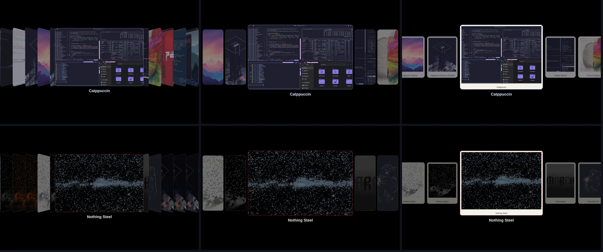

# Omarchy Image Picker Styles

[🇬🇧 English](README.md)

Шесть стилей для пикера картинок [Omarchy](https://omarchy.org) — оверлея, через который работают выбор темы
и выбор обоев. Клон стокового `omarchy.image-picker`; навигация, поиск и выбор — как в стоке.



<!-- Demo video: repo-videos/omarchy-image-picker-styles.mp4 — drag it here when editing this file on GitHub -->

`slices` (сток), `cards`, `coverflow`, `polaroid`, `strip`, `wide`, `honeycomb` (соты: крупный шестиугольник в центре, соседи кольцами шестиугольников — по мотивам Vitreus), `dots` (круглые миниатюры; превью собирается из точек волной, `shaders/dots.frag` — по мотивам glyph-rice).

## Установка

```sh
omarchy plugin add https://github.com/KamradSmeshnyavy/omarchy-image-picker-styles --enable
omarchy restart shell
echo '{"style": "coverflow"}' > ~/.config/omarchy/image-picker.json
```

Открывается как обычно: Super+Shift+Ctrl+Space (темы) или Super+Ctrl+Space (обои). Вернуть стоковый
пикер: `omarchy plugin enable omarchy.image-picker`.


## Требования

Omarchy 4 (Quattro) с его оболочкой. Проверено на Omarchy 4.0.6 и Quickshell 0.3.2.

- Необязательно: `libvips` — быстрые миниатюры (пакет `libvips`).

## Удаление

```sh
omarchy plugin enable omarchy.image-picker      # сначала вернуть стоковый
omarchy plugin remove kamradsmeshnyavy.image-picker
omarchy restart shell
```

Настройки остаются в `~/.config/omarchy/image-picker.json` — удалите их вручную, если не нужны.


## Живые обои

Видео (`mp4` `webm` `mkv` `mov` `m4v`) в списке вместе с картинками, играет их движок обоев Omarchy
[owe](https://github.com/omacom/owe). Миниатюра — кадр, который `ffmpeg` берёт при первом показе (в тот же кэш), у живых
обоев (видео и GIF) значок ▶, а `live` (или `живые`) в строке фильтра оставляет только их. Если живые обои в списке есть, над каруселью переключатель **All · Static · Animated** — `j` / `k`
или `↑` / `↓` (`Ctrl+j` / `Ctrl+k`, если в пикере есть фильтр), или кликом.

## Настройки — `~/.config/omarchy/image-picker.json`

Читается на лету. `style` выбирает пресет, остальные ключи переопределяют его числа; `0` / `-1` или
отсутствие ключа — значение стиля (или темы).

| Ключ | |
|---|---|
| `style` | `slices` `cards` `coverflow` `polaroid` `strip` `wide` |
| `expandedWidth`, `expandedHeight` | размер выбранной картинки |
| `sliceWidth`, `sliceHeight` | размер остальных |
| `spacing` | зазор (отрицательный — наложение) |
| `skew` | наклон срезов |
| `cardRadius` | радиус углов |
| `dim` | затемнение невыбранных, 0–1 (по умолчанию 0.42) |
| `selectedBorder` | толщина рамки выбранной (3) |
| `animMs` | длительность анимации (160) |
| `scrimAlpha` | альфа подложки; -1 — из темы |
| `labels` | `true` — подписи всегда |

Правки стокового `ImagePicker.qml` помечены `// picker:`. `list.sh` переписан ради скорости (один `stat` и один `awk` по индексу миниатюр на все картинки, а не на каждую): 13 обоев 0,6 с → 0,09 с, 150 превью тем 2,2 с → 0,11 с, вывод тот же.

В [моих dotfiles](https://github.com/KamradSmeshnyavy/dotfiles) стиль и числа подбираются в оверлее
Customizer; он же кэширует миниатюры после смены темы, поэтому пикеры с сотнями обоев открываются мгновенно.

## Вместе с Customizer

[omarchy-customizer](https://github.com/KamradSmeshnyavy/omarchy-customizer) — один оверлей (Super+Shift+T) с живым предпросмотром для настроек этого
плагина и всего остального оформления: темы, обои, анимации Hyprland, прозрачность, блюр, шейдеры экрана.
Поставьте его рядом с этим плагином (остальные компаньоны он найдёт сам):

```sh
omarchy plugin add https://github.com/KamradSmeshnyavy/omarchy-customizer --enable
```

## Лицензия

MIT. Основано на `omarchy.image-picker` из [Omarchy](https://github.com/basecamp/omarchy) (MIT, © David
Heinemeier Hansson).
