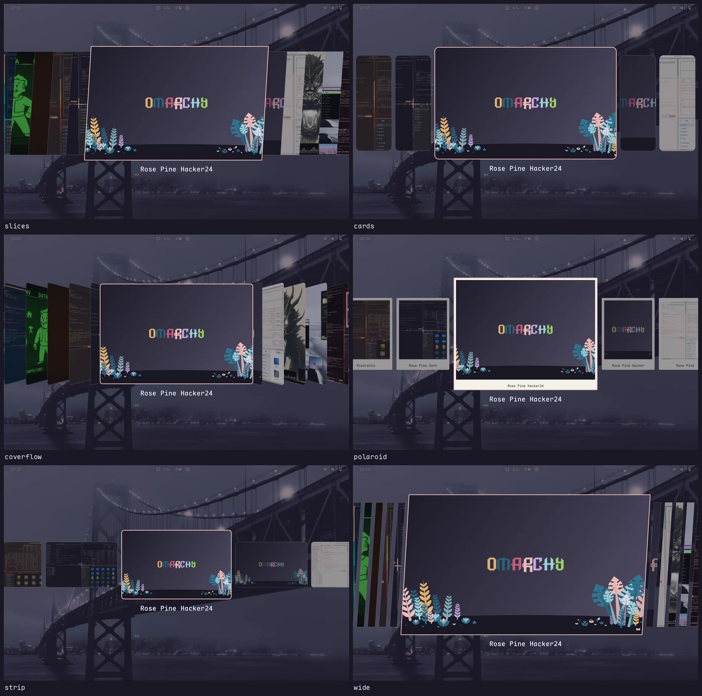

# Omarchy Image Picker Styles

[🇬🇧 English](README.md)

Шесть стилей для пикера картинок [Omarchy](https://omarchy.org) — оверлея, через который работают выбор темы
и выбор обоев. Клон стокового `omarchy.image-picker`; навигация, поиск и выбор — как в стоке.



`slices` (сток), `cards`, `coverflow`, `polaroid`, `strip`, `wide`.

## Установка

```sh
omarchy plugin add https://github.com/KamradSmeshnyavy/omarchy-image-picker-styles --enable
omarchy restart shell
echo '{"style": "coverflow"}' > ~/.config/omarchy/image-picker.json
```

Открывается как обычно: Super+Shift+Ctrl+Space (темы) или Super+Ctrl+Space (обои). Вернуть стоковый
пикер: `omarchy plugin enable omarchy.image-picker`.

Проверено на Omarchy 4.0.6 и Quickshell 0.3.2.

## Настройки — `~/.config/omarchy/image-picker.json`

Читается на лету. `style` выбирает пресет, остальные ключи переопределяют его числа; `0` / `-1` или
отсутствие ключа — значение стиля (или темы).

| Ключ | |
|---|---|
| `style` | `slices` `cards` `coverflow` `polaroid` `strip` `wide` |
| `expandedWidth`, `expandedHeight` | размер выбранной картинки |
| `sliceWidth`, `sliceHeight` | размер остальных |
| `spacing` | зазор (отрицательный — наложение) |
| `skew` | наклон срезов |
| `cardRadius` | радиус углов |
| `dim` | затемнение невыбранных, 0–1 (по умолчанию 0.42) |
| `selectedBorder` | толщина рамки выбранной (3) |
| `animMs` | длительность анимации (160) |
| `scrimAlpha` | альфа подложки; -1 — из темы |
| `labels` | `true` — подписи всегда |

Правки стокового `ImagePicker.qml` помечены `// picker:`.

В [моих dotfiles](https://github.com/KamradSmeshnyavy/dotfiles) стиль и числа подбираются в оверлее
Customizer; он же кэширует миниатюры после смены темы, поэтому пикеры с сотнями обоев открываются мгновенно.

## Лицензия

MIT. Основано на `omarchy.image-picker` из [Omarchy](https://github.com/basecamp/omarchy) (MIT, © David
Heinemeier Hansson).
